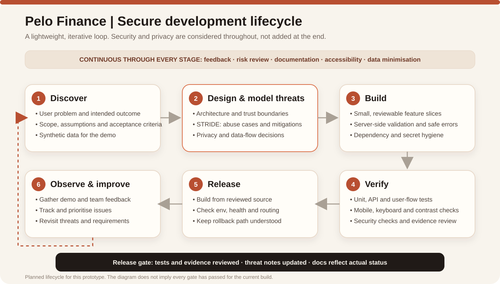

# Pelo Finance

**Make your money story visible.**


[Live demo](https://pelo-finance.vercel.app/) · [Source repository](https://github.com/kopommops/pelo-finance)

Pelo Finance is a hackathon prototype exploring a practical question: how can people who earn irregularly make better sense of the money that moves through their lives? Income may arrive by day, week, season, cash sale, client job or several small streams. A single balance rarely tells the whole story. People also need to understand the pattern behind the balance: what came in, what went out, what a lean week might look like, and which assumptions shape the forecast.

Pelo Finance is being built around visibility rather than judgement. The goal is to turn a scattered money story into something people can explore, explain and plan around. **PeloScore** is an early, illustrative financial-consistency concept within that experience, not a credit score or a lending decision.

> **Demo safety:** all profiles and transactions in this build are synthetic. The demo is not connected to a bank or mobile-money provider. Forecasts are estimates, and PeloScore is not statistically validated. Do not use this prototype for lending, pricing, eligibility, or other consequential decisions.


## The experience

The public demo is designed to let a reviewer follow the money story without sharing real financial information:

1. **Choose a synthetic livelihood.** Explore an example profile rather than connecting a real account.
2. **Read the pattern.** Review cash-flow activity and a summary of the demo profile.
3. **Look ahead.** Explore a seven-day forecast, understanding that forecasts are estimates rather than promises.
4. **Stress-test a lean week.** Compare the scenario with the baseline and observe how the outlook changes.
5. **Inspect PeloScore.** Review an illustrative consistency signal with its limitations clearly stated.

The public landing page introduces the idea; choosing **Explore the demo** opens the synthetic-data journey. The experience is intentionally transparent about the difference between a prototype and a real financial service.

The current workspace routes are `/app/overview`, `/app/activity`, `/app/forecast`, `/app/peloscore` and `/app/settings`.

## Product snapshot

| | Current prototype |
|---|---|
| Product | Pelo Finance |
| Flagship concept | PeloScore |
| Audience hypothesis | People with irregular, seasonal, cash-based or multiple income sources, including small traders and independent service providers |
| Frontend | React, TypeScript, Vite, Tailwind CSS, Headless UI, Lucide and Recharts |
| Backend | Python, FastAPI and SQLAlchemy |
| Local persistence | SQLite by default; deployment database depends on environment configuration |
| Hosting | Public frontend on Vercel and API hosted separately |
| Data | Synthetic demo personas and transactions |
| Readiness | Hackathon prototype; not ready for real customer financial data |

## How the system fits together

The solid path represents the current demo architecture. The dashed section is a hardening roadmap, not a claim that those controls are implemented.


Current technology responsibilities:

- **React + TypeScript** provide the browser experience and route-level screens.
- **Vite and Tailwind CSS** support frontend development and styling.
- **Headless UI, Lucide and Recharts** provide accessible interface primitives, icons and data visualisations.
- **FastAPI** exposes the demo API, including persona, dashboard, transaction and scenario endpoints.
- **SQLAlchemy** provides the persistence layer; SQLite is the local default. Confirm the actual deployed database from deployment configuration rather than inferring it from local settings.
- **Vercel and the separate API host** publish the web UI and backend independently. The frontend's API base URL must point to the intended deployed API origin.

### Demo API surface

| Method | Endpoint | Purpose |
|---|---|---|
| `GET` | `/api/health` | Service health check |
| `GET` | `/api/personas` | List synthetic demo profiles |
| `GET` | `/api/personas/{id}/dashboard` | Return a profile dashboard summary |
| `GET` | `/api/personas/{id}/transactions` | Return synthetic transactions |
| `POST` | `/api/personas/{id}/simulate-lean-week` | Activate a lean-week demo scenario |
| `POST` | `/api/personas/{id}/reset-scenario` | Reset a profile to baseline |

These are prototype endpoints, not a user-authenticated financial-data API.

## Behind the scenes: how we're approaching development

Pelo Finance is being developed incrementally: start with a small end-to-end experience, test the journey, collect feedback, and prioritise the next improvement. Product decisions, visual design, code and security notes should describe the same reality.

### Agile delivery, pragmatically applied

We break work into manageable slices such as the demo journey, responsive navigation, cash-flow views, forecasting and scenario behaviour. The intended loop is to prioritise a small backlog, agree what a change should achieve, implement it, review the result, test the changed path and record follow-up issues. Scrum-style planning, check-ins, reviews and retrospectives are useful team practices where the team actually performs them; this README does not imply that every formal Scrum ceremony has been conducted.

### Secure Software Development Lifecycle (SSDLC)

Security belongs throughout the development lifecycle, not only just before deployment. Our documented lifecycle is:



The lifecycle is a process target. Each release still needs evidence that its relevant build, functional, accessibility and security checks passed. A diagram or checklist alone is not proof of a completed review.

### STRIDE threat modelling

STRIDE gives the team a vocabulary for exploring six classes of threat:

- **Spoofing:** someone pretends to be another user or service.
- **Tampering:** a client alters transaction values, identifiers or scenario inputs.
- **Repudiation:** a sensitive action cannot be traced to a reliable event record.
- **Information disclosure:** a user sees someone else's records or a log exposes sensitive data.
- **Denial of service:** an endpoint or import consumes excessive resources.
- **Elevation of privilege:** a user or service gets permissions beyond its role.

For Pelo Finance, these risks make authentication, server-side ownership checks, safe import handling, secret management, data minimisation and negative authorization tests important future gates. The current product remains synthetic-data-only while these controls are being built and verified. The threat-modelling work is an initial design exercise, not an independent penetration test or security certification.

### Engineering principles

- **Make the demo honest:** synthetic data and simulation are labelled as such.
- **Protect money meaning:** use exact decimal or integer-minor-unit arithmetic for authoritative ledger calculations before real balances are supported.
- **Trust the server, not client IDs:** future account routes must derive identity from verified authentication and enforce record ownership on every request.
- **Design for failure:** loading, empty, validation, error and retry states should be clear and accessible.
- **Reduce data exposure:** do not place secrets in frontend variables or logs; collect only data the product needs.
- **Verify before claiming:** treat planned controls as planned until code and tests provide evidence.

### Frameworks and references

The secure-development plan is informed by the NIST Secure Software Development Framework (SSDF), OWASP Application Security Verification Standard (ASVS), and OWASP application-security guidance. They are reference frameworks, not certifications, and no compliance claim is made by naming them.

- [NIST Secure Software Development Framework (SSDF)](https://csrc.nist.gov/pubs/sp/800/218/final)
- [OWASP Application Security Verification Standard (ASVS)](https://owasp.org/www-project-application-security-verification-standard/)
- [OWASP Top 10](https://owasp.org/www-project-top-ten/)

## Run locally

Use Node.js 20 or newer and Python 3.11 or newer.

### 1. Start the API

```bash
cd backend
python -m venv .venv
```

Windows PowerShell:

```powershell
.\.venv\Scripts\Activate.ps1
```

macOS/Linux:

```bash
source .venv/bin/activate
```

Then install and run the backend:

```bash
python -m pip install -r requirements.txt
uvicorn app.main:app --reload --port 8000
```

Copy `backend/.env.example` to `backend/.env` if local overrides are required. Keep secrets out of source control. Confirm the configured `DATABASE_URL` before assuming where the local database lives.

### 2. Start the frontend

In a second terminal:

```bash
cd frontend
npm install
```

Copy the example environment file:

```powershell
Copy-Item .env.example .env.local
```

Set `VITE_API_BASE_URL=http://localhost:8000` in `frontend/.env.local` for local development and set `VITE_CURRENCY=BWP` unless you are deliberately testing another display currency. Then run:

```bash
npm run dev
```

### 3. Build and test

```bash
cd frontend
npm run build
```

From the backend directory:

```bash
python -m pytest
```

The browser SPA fallback is configured in `frontend/vercel.json` so refreshing a workspace route should serve the frontend entry point. Verify that network requests use the intended backend origin in the browser developer tools.

## What is implemented, and what is still ahead?

### Implemented in the prototype

- Public product landing page and synthetic-demo onboarding.
- Synthetic personas and transaction history.
- Dashboard summaries and seven-day forecast experience.
- Lean-week scenario toggle and baseline comparison.
- Illustrative PeloScore presentation and demo safety disclosure.
- Responsive layout and light/dark theme foundations in the replacement frontend.

### Required before real financial data

1. Server-verified authentication, session lifecycle and authorization.
2. User/business ownership checks for every record and endpoint, with cross-account isolation tests.
3. Private scenario state so one demo visitor cannot affect another visitor's experience.
4. Managed persistent database, Alembic migrations, backup/restore exercises and a data-retention/deletion policy.
5. Exact monetary arithmetic, transaction validation, robust import controls and idempotency.
6. Security testing, incident response, secret handling, monitoring and a documented release/rollback process.
7. Privacy and regulatory review, explicit consent, and an approved provider integration before any real bank or mobile-money data is introduced.
8. A documented, versioned PeloScore methodology and representative validation before any predictive or outcome-related claims.

Do not enter actual bank credentials, OTPs or real transaction data into this prototype. Real financial integrations should use approved provider-hosted consent/authorization flows, never a form that collects bank passwords.

## Project documentation

- [Product requirements](PRD.md)
- [Design system](DESIGN.md)
- [Secure development lifecycle](docs/ssdlc.md)
- [STRIDE threat model](docs/threat-model.md)
- [Architecture notes](docs/system-architecture.md)

## Feedback

This is an evolving hackathon project. Feedback is especially useful on whether the product story is clear, whether the cash-flow and lean-week views are understandable, and what a user would need to trust the experience. Please report UI issues, confusing language, accessibility problems or missing test cases through the repository's issue workflow.

---

**Pelo Finance** — *Make your money story visible.*