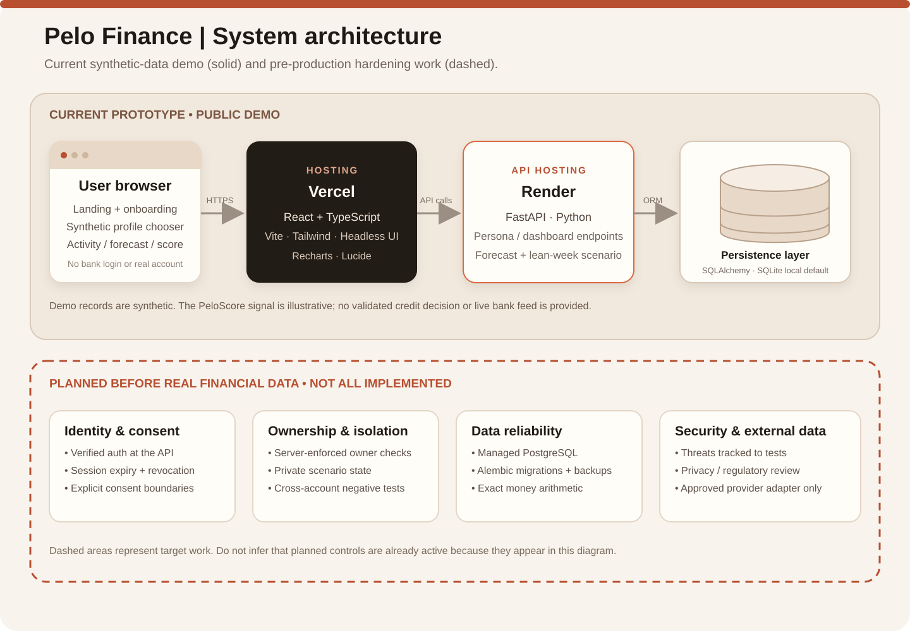

# Pelo Finance system architecture

## Current prototype

The browser serves the React/TypeScript application hosted on Vercel. Frontend API calls use the configured API base URL. The separately hosted FastAPI service exposes synthetic persona, dashboard, transaction and scenario behaviour, with SQLAlchemy as the persistence layer. SQLite is the local default; the actual deployed database must be verified from deployment configuration.

The demo has no live bank connection. Its personas and transaction history are synthetic; PeloScore is illustrative. Depending on runtime configuration, shared seeded scenario state may still be shared across visitors, so the prototype must not be treated as multi-tenant or used with real financial data.

## Hardening before real customer data

- Add server-verified authentication and explicit consent controls.
- Enforce owner/business access checks on every protected request.
- Isolate scenario state by authenticated session or owner.
- Use managed database hosting, versioned migrations, backups and restore tests.
- Replace float-based authoritative money calculations with integer minor units or exact decimals.
- Add import limits, validation, deduplication and idempotency before accepting files.
- Establish logging, monitoring, retention, deletion, incident response and privacy review.
- Use only approved provider authorization for real banking integrations.

The dashed section of the diagram is target work, not a claim that it is already implemented.
